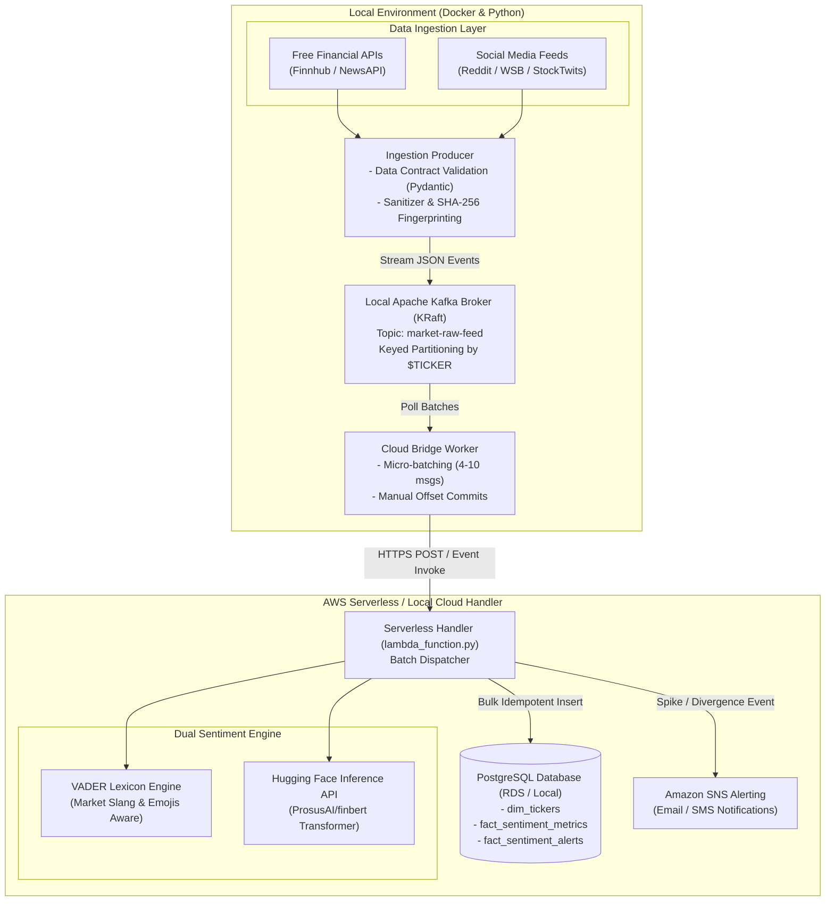

# Autonomous Market & Social Sentiment Trend Monitoring Pipeline (AMSSTMP)

[](https://www.python.org/downloads/)
[](https://kafka.apache.org/)
[](https://www.postgresql.org/)
[](https://aws.amazon.com/)
[](https://opensource.org/licenses/MIT)

A lightweight, hybrid local-to-cloud analytics architecture designed to identify emerging financial trends by processing social chatter and formal financial disclosures. Unifies local containerized data streaming, serverless functions, a dual NLP scoring engine (VADER + FinBERT), and an autonomous alerting mechanism at virtually zero infrastructure cost.

---

## 📌 Architecture Overview



---

## 📊 Core Data Engineering Principles

1. **Decoupled Stream Buffering & Backpressure**: Decouples high-frequency API ingestion from cloud downstream compute using containerized Apache Kafka with KRaft consensus.
2. **Deterministic Partition Keying**: Records are keyed by ticker (`$AAPL`, `$TSLA`), guaranteeing strict temporal ordering per asset across Kafka partitions.
3. **Strict Data Contracts & Schema Evolution**: Validated through Pydantic models (`RawFeedItem`) enforcing non-empty fields, ISO-8601 timestamps, and source categorization enums.
4. **Data Deduplication & Medallion Design**:
   - **Bronze**: Raw unmodified text stored for auditability.
   - **Silver**: Sanitized text with HTML/URLs stripped while retaining emojis and casing.
   - **Deterministic Hash**: SHA-256 fingerprint generated from `(source + published_at + text)` for idempotent `ON CONFLICT DO NOTHING` persistence.
5. **Dual-Model NLP Sentiment Routing**:
   - **Informal Social Content**: Routed to market-lexicon-enhanced VADER ($< 1\text{ms}$ latency).
   - **Formal Financial News**: Routed to Hugging Face FinBERT transformer endpoint, with graceful local fallback.
6. **Relational Dimensional Modeling**: B-Tree composite indexed fact tables (`fact_sentiment_metrics`, `fact_sentiment_alerts`) supporting sub-second analytical aggregations and divergence detection.

---

## 🗺️ Project Phases

| Phase | Milestone | Status | Key Deliverables |
|---|---|:---:|---|
| **Phase 1** | Streaming Infrastructure | ✅ Complete | Docker Compose Kafka (KRaft), topic creation, Python environment |
| **Phase 2** | Ingestion & Data Contracts | ✅ Complete | Pydantic schema validation, regex text cleaner, Kafka producer |
| **Phase 3** | Persistence & Relational Model | ✅ Complete | PostgreSQL DDL (`dim_tickers`, `fact_sentiment_metrics`, `fact_sentiment_alerts`), DB Manager |
| **Phase 4** | Dual Sentiment Engine | ✅ Complete | Financial VADER dictionary injection, FinBERT API client, serverless handler |
| **Phase 5** | Streaming Cloud Bridge | ✅ Complete | Micro-batching consumer, manual offset commit semantics, concurrent E2E runner |
| **Phase 6** | Analytics & Divergence SQL | ✅ Complete | Rolling hourly moving averages, retail vs. institutional divergence queries |

---

## 🛠️ Repository Structure

```
AMSSTMP/
├── docker/
│   └── docker-compose.yml              # Apache Kafka (KRaft) & PostgreSQL 16 containers
├── src/
│   ├── ingestion/
│   │   ├── schemas.py                  # Pydantic data contract models
│   │   ├── text_cleaner.py             # Sanitization, ticker extraction & SHA-256 fingerprinting
│   │   ├── kafka_producer.py           # Kafka producer with ticker partition keys
│   │   └── fetchers/
│   │       ├── base_fetcher.py         # Abstract base fetcher class
│   │       ├── mock_fetcher.py         # Synthetic market & social feed generator
│   │       └── finnhub_fetcher.py      # Real-time Finnhub news API fetcher
│   ├── streaming/
│   │   └── cloud_bridge.py             # Micro-batch consumer with manual offset commits
│   ├── cloud/
│   │   ├── sentiment_engine.py         # Dual NLP (VADER + FinBERT API)
│   │   ├── db_manager.py               # Bulk idempotent database operations
│   │   ├── alert_manager.py            # Amazon SNS anomaly event dispatcher
│   │   └── lambda_function.py          # Unified serverless batch processing handler
│   ├── database/
│   │   ├── schema.sql                  # PostgreSQL DDL and composite indexes
│   │   └── analytics_queries.sql       # Hourly moving average & divergence queries
│   └── pipeline_runner.py              # Master multi-threaded end-to-end streaming runner
├── tests/
│   ├── test_schemas.py                 # Contract & sanitizer unit tests
│   └── test_sentiment.py               # NLP polarity & financial lexicon unit tests
├── .env.example                        # Template for environment variables
├── requirements.txt                    # Project dependencies
├── pytest.ini                          # Pytest configuration
└── README.md
```

---

## 🚀 Quickstart Guide

### 1. Prerequisites
- Docker & Docker Desktop
- Python 3.10+
- (Optional) Free Hugging Face API Token & AWS Account for Cloud Deployment

### 2. Environment Setup
```bash
# Clone the repository
git clone https://github.com/Adios25/AMSSTMP.git
cd AMSSTMP

# Create and activate Python virtual environment
python3 -m venv .venv
source .venv/bin/activate

# Install dependencies
pip install -r requirements.txt

# Configure environment variables
cp .env.example .env
```

### 3. Start Local Infrastructure (Kafka & PostgreSQL)
```bash
# Spin up containers
docker compose -f docker/docker-compose.yml up -d

# Initialize database schema
python -c "from src.cloud.db_manager import DatabaseManager; db = DatabaseManager(); db.init_schema()"
```

### 4. Run Unit Tests
```bash
pytest tests/ -v
```

### 5. Execute End-to-End Pipeline
```bash
python -m src.pipeline_runner
```

### 6. Inspect Results & Run Analytical Queries
```bash
# Run analytical queries (Rolling Averages, Sentiment Divergence, Anomalies)
docker exec -i amsstmp-postgres psql -U postgres -d postgres < src/database/analytics_queries.sql
```

---

## 📈 Sample Analytical Output

### Retail vs. Institutional Divergence
```sql
 ticker | social_sentiment | news_sentiment | divergence_delta |   divergence_regime   
--------+------------------+----------------+------------------+-----------------------
 MSFT   |          -0.4963 |         0.5115 |           1.0077 | RETAIL_BEAR_NEWS_BULL
 TSLA   |          -0.4963 |         0.2634 |           0.7596 | RETAIL_BEAR_NEWS_BULL
 AAPL   |          -0.2023 |         0.4179 |           0.6202 | RETAIL_BEAR_NEWS_BULL
 NVDA   |           0.7815 |         0.2634 |           0.5181 | ALIGNED_OR_MILD
```

---

## ☁️ Deploying to AWS (Next Steps)

For full AWS deployment without monthly fees:
1. **Amazon RDS (PostgreSQL)**: Deploy a `db.t3.micro` or `db.t4g.micro` under the Free Tier. Update `DB_HOST`, `DB_USER`, and `DB_PASSWORD` in `.env`.
2. **AWS Lambda**: Package `src/cloud/` with dependencies into a container image or Lambda zip archive pointing entrypoint to `src.cloud.lambda_function.lambda_handler`.
3. **Amazon SNS**: Create a standard topic `market-sentiment-alerts` and subscribe an email or phone number. Put the ARN into `SNS_TOPIC_ARN`.
4. **Local-to-Cloud Bridge**: In `src/streaming/cloud_bridge.py`, change `lambda_handler(event)` to invoke the AWS Lambda client directly via `boto3.client('lambda').invoke(...)` or via an API Gateway HTTPS endpoint.

---

## 📜 License
This project is open-source under the MIT License.
